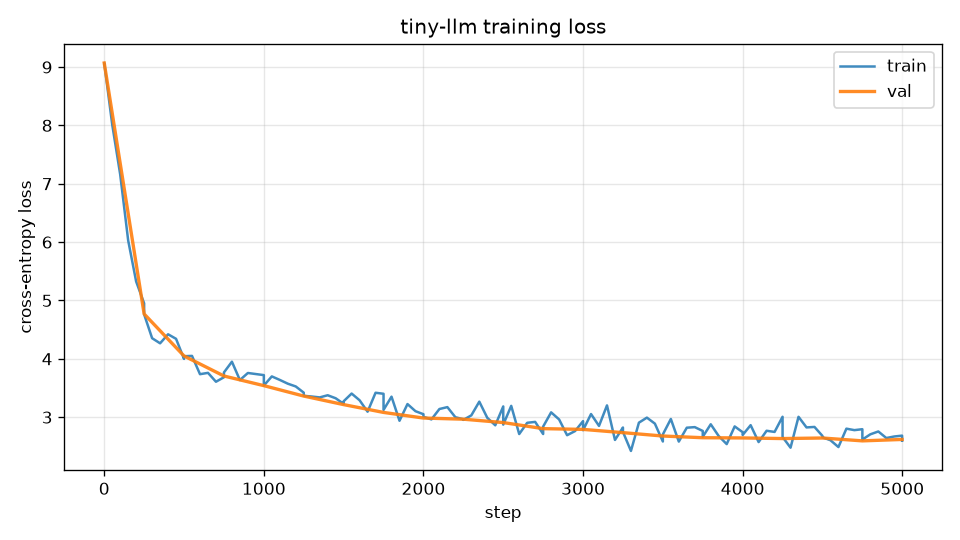

# tiny-llm

A tiny **GPT-style language model trained from scratch** on [TinyStories](https://arxiv.org/abs/2305.07759): data → BPE tokenizer → decoder-only transformer → train → val perplexity → samples.

No product UI. Pure ML train → eval → writeup — the interview artifact for “I can train an LM end-to-end.”

## Headline results (tiny-cpu)

Trained the full **tiny** architecture on a **4-core CPU (no GPU)** with `configs/tiny-cpu.yaml`:

| | |
| --- | --- |
| **Parameters** | **13.8M** |
| Architecture | 6 layers · 384 d_model · 6 heads · context 256 · vocab 8,000 |
| Data | ~49M train chars / ~1M val chars (TinyStoriesV2-GPT4, capped) |
| Schedule | 5,000 steps · AdamW · lr 3e-4 · warmup 200 · cosine decay |
| Batch | micro-batch 8 × grad-accum 4 (**effective 32**, matches `tiny.yaml`) |
| **Best val perplexity** | **≈ 13.4** |
| Held-out eval ppl | ≈ 14.2 |
| Wall clock | ≈ **58 minutes** on 4× CPU, float32 |

Loss curve:



### Sample (temperature 0.8)

> Once upon a time, in a small town, there was a little girl named Lily. She lived in a small house with her mom. Lily loved to play outside with her toys and seek. One day, Lily's mom asked her, "Mom, can I play with me?"  
> Lily said, "Yes, but I need to play today." Her mom smiled and said, "We can play together." Lily was very happy and played with her toys with her toys. They had lots of fun, and Lily was happy.

More samples: [`artifacts/demo/samples.md`](artifacts/demo/samples.md). Prose is coherent TinyStories-style English with remaining grammar/consistency glitches — expected at ~14 ppl / 13.8M / 5k steps; a longer GPU `tiny.yaml` run should tighten this further.

## What you get

| Piece | Details |
| --- | --- |
| Data | TinyStoriesV2-GPT4 (public HF dump), capped train/val text |
| Tokenizer | Byte-level BPE (`tokenizers`), vocab 1k smoke / **8k tiny** |
| Model | Decoder-only transformer (causal attn + MLP), weight-tied LM head |
| Train | AdamW, cosine LR w/ warmup, grad clip, checkpoints, JSONL loss log |
| Eval | Held-out cross-entropy → **perplexity**, generation script, loss curve plot |

## Architecture

```
token + position embed
  → N × (LayerNorm → causal MHA → residual → LayerNorm → MLP → residual)
  → LayerNorm → tied LM head
```

| Config | Params | Layers | d_model | Heads | Context | Vocab | Target |
| --- | --- | --- | --- | --- | --- | --- | --- |
| `smoke.yaml` | ~0.17M | 2 | 64 | 2 | 64 | 1,024 | Pipeline / CI smoke |
| **`tiny-cpu.yaml`** | **~13.8M** | **6** | **384** | **6** | **256** | **8,000** | **Serious CPU run (this README)** |
| `tiny.yaml` | ~13.8M | 6 | 384 | 6 | 256 | 8,000 | Same model on GPU (bf16, larger micro-batch) |

`tiny-cpu.yaml` and `tiny.yaml` share the **same model**; CPU uses float32 + micro-batch 8 × accum 4 to keep an effective batch of 32 without a GPU.

### Hyperparameters (tiny / tiny-cpu)

| Knob | Value |
| --- | --- |
| Optimizer | AdamW (β₁=0.9, β₂=0.95), weight decay 0.1 |
| Learning rate | 3×10⁻⁴ with 200-step linear warmup + cosine to 10% |
| Grad clip | 1.0 |
| Dropout | 0.1 |
| Bias in Linear | off |
| Weight tying | embedding ↔ LM head |

## Reproduce

```bash
python3 -m venv .venv && source .venv/bin/activate
pip install -e .

# Serious CPU run (same model as tiny.yaml; ~1 hour on 4 cores)
python3 -m tiny_llm.cli prepare   --config configs/tiny-cpu.yaml
python3 -m tiny_llm.cli tokenizer --config configs/tiny-cpu.yaml
python3 -m tiny_llm.cli train     --config configs/tiny-cpu.yaml
python3 -m tiny_llm.cli eval      --config configs/tiny-cpu.yaml
python3 -m tiny_llm.cli generate  --config configs/tiny-cpu.yaml
```

### GPU (optional, faster)

```bash
python3 -m tiny_llm.cli prepare   --config configs/tiny.yaml
python3 -m tiny_llm.cli tokenizer --config configs/tiny.yaml
python3 -m tiny_llm.cli train     --config configs/tiny.yaml
python3 -m tiny_llm.cli eval      --config configs/tiny.yaml
python3 -m tiny_llm.cli generate  --config configs/tiny.yaml --prompt "Once upon a time"
```

### Smoke (pipeline only)

```bash
python3 -m tiny_llm.cli prepare   --config configs/smoke.yaml
python3 -m tiny_llm.cli tokenizer --config configs/smoke.yaml
python3 -m tiny_llm.cli train     --config configs/smoke.yaml
python3 -m tiny_llm.cli eval      --config configs/smoke.yaml
python3 -m tiny_llm.cli generate  --config configs/smoke.yaml
```

Tips:

- Checkpoints land in `checkpoints/` (gitignored, ~158MB for tiny-cpu). Plots/metrics/samples live under `artifacts/demo/`.
- Token ID caches fingerprint source text + tokenizer so smoke → tiny never reuses stale IDs.
- Raise `train.max_steps` / `data.max_train_chars` for a longer run.

## Layout

```
configs/               smoke · tiny-cpu · tiny
src/tiny_llm/          data, tokenizer, model, train, eval, generate, CLI
artifacts/
  tokenizer/           committed 8k BPE from the tiny-cpu run
  demo/                loss curve, metrics, samples
tests/                 unit tests (no network / no GPU)
```

## Interview talking points

1. **Tokenizer from scratch** — trained byte-level BPE on the corpus (not `tiktoken`).
2. **Model from scratch** — causal self-attention, residuals, LayerNorm, weight tying; size is a YAML knob.
3. **Train hygiene** — seed control, warmup + cosine LR, grad clip, best/last checkpoints, logged curves.
4. **Honest metrics** — held-out perplexity **≈13.4** + readable samples on CPU; GPU `tiny.yaml` for faster iteration / longer schedules.
5. **Reproducibility** — one config file drives data caps, vocab, architecture, and train schedule.

## License

MIT
